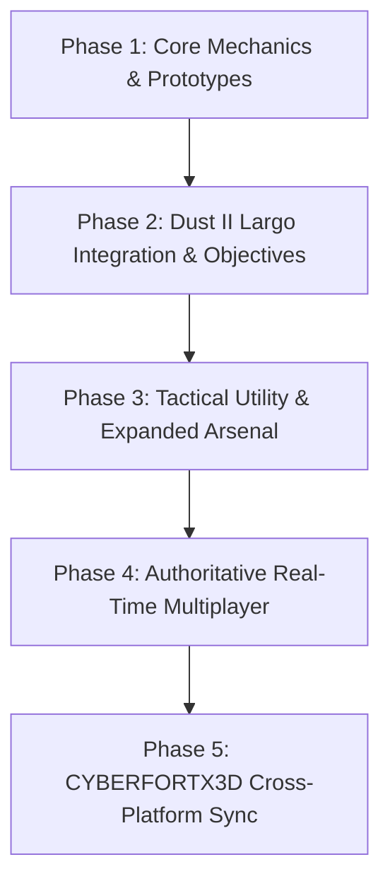

# TacOps: Tactical Web Shooter

A high-performance, responsive 3D tactical shooter inspired by Counter-Strike, built from the ground up using **Three.js**, **WebGL**, and modern **JavaScript (ES Modules + Vite)**.

> **Project Note**: TacOps is a lightweight, zero-install, web-based secondary tactical project developed alongside the flagship Unity project **CYBERFORTX3D**. It serves as an agile testbed for tactical gunplay mechanics, procedural audio synthesis, bot behavioral AI, and web-native tactical gameplay that will ultimately interface with the CYBERFORTX3D ecosystem.

---

## ⚡ Quick Play & Releases

> **Note for Beginners**:
> It is **much easier to simply go to the [Releases](https://github.com/Suboycode1234/TacOps/releases) section** and download the standalone `Tacops_standalone.html` file!
> 
> * **Zero Installation**: Double-click `Tacops_standalone.html` in Windows or open it in any modern browser (Chrome, Edge, Firefox) to play offline immediately.
> * **Developer Server**: Running locally via `npm run dev` and `index.html` is only recommended for those who know how to run a dev server or want to contribute to the code.
> * **Distribution Notice**: The standalone HTML file is **NOT provided in the standard GitHub repository source code `.zip`**, it is **only available through GitHub Releases**.

---

## 🐛 Known Bugs & Upcoming Features (Active Tracking)

The following bugs and feature requests are actively prioritized:

- [x] **Knife Animations & Scale Bug**: Tactical knife model calibrated to 0.38m realistic scale, rotated forward, and keyframe tracks normalized to 0.0s start.
- [x] **Falling Out of Map Bug**: Player and bots now protected with full BSP wall segment collision, boundary clamping, and void fall safety net.
- [x] **Terrorist 3rd Person Orientation Bug**: Inverted Terrorist model yaw in player 3rd person perspective.
- [ ] **Difficulty to Kill Enemy Bots Bug**: Enemy bot HP and evasion parameters need re-tuning for balanced, enjoyable combat.
- [x] **No Reliable GUI Weapon Selection Bug**: Added clickable on-screen Tactical Weapon Selector HUD [1] [2] [3] and [B] Arsenal Requisition.
- [ ] **Movement Does Not Affect Aim Spread**: Dynamic crosshair bloom and accuracy penalties when sprinting or moving need realistic tuning.
- [ ] **Bot Over-Movement**: Enemy bots currently move around excessively; requires tactical hold-angle pauses and smoother patrol waypoints.
- [ ] **Weapon Damage Scaling**: Lack of damage falloff curves over long distances.
- [ ] **Scoped Weapons Zoom Overlay**: Scoped weapons currently lack specialized optical reticle overlays.
- [x] **Hitbox / Body Part Damage Scaling**: Implemented full body part damage scaling across Head (3.5x - 4x), Torso (1.0x), and Limbs (0.75x) with helmet and armor absorption.

---

## 🎮 Key Features

- **Authentic Tactical Gunplay**:
  - Full arsenal including M16A3 Assault Rifle, Desert Eagle .50 AE, P90 Tactical Submachine Gun, and Tactical Combat Knife with 4-swing combo.
  - Dynamic recoil kick, recovery physics, movement inaccuracy penalty, and Aim Down Sights (ADS) precision zoom.
  - Procedural Web Audio synthesizer generating realistic gunshot transients, mechanical slide actions, dry fires, hitmarkers, headshot dinks, and footsteps.
- **Counter-Strike Economy & Buy Menu**:
  - Complete CS Requisition Buy Menu (`B` key) with weapon categorization, detailed stat bars (Damage, Fire Rate, Spread, Mobility), and cash management.
  - Active Buy Zone boundaries with automatic round rewards and kill bonuses.
- **High-Fidelity FBX Character Models & PBR Textures**:
  - **Counter-Terrorists**: Gas Mask Tactical Soldier with 4K PBR materials (Base Color, Normal, Roughness, Metallic) and 69-bone armature.
  - **Terrorists**: Classic Phoenix Guerrilla operative with authentic gear.
- **Seamless Merged Skeletal Animations**:
  - Programmatic keyframe track merge combining `jumpstart` and `jumpland` into a single unified 2.60s jumping animation.
  - Root motion translation neutralized into in-place animations (`walk_loop`, `jog_fwd_loop`, and `jump`), keeping character meshes in 100% sync with the camera and player controller.
  - Tactical sprint (`Shift`) activating running animations, standard walking by default, and smooth cross-fading.
- **Third-Person & First-Person Camera Toggle**:
  - Seamless toggle (`V` key) between first-person viewmodel and over-the-shoulder third-person tactical perspective with held weapon attachments.
- **Advanced Tactical Enemy AI**:
  - Lateral combat strafing and jiggle-peeking during firefights.
  - Audio perception: bots hear gunshots and sprint footsteps within 38 meters and turn to investigate.
  - Realistic reaction delays, distance-dependent burst firing (rapid close spray vs controlled long-range taps), and magazine tracking with tactical reload retreats.
  - Overhead tactical status billboards displaying bot team, real-time health bars, and alert states (`[PATROL]`, `[ALERT !]`, `[ENGAGING]`, `[RELOAD]`).
  - Smooth death collapse physics.
- **Maps**:
  - Tactical Training Arena with interactive bullseye targets and ballistic feedback.
  - Dust II Largo (`de_dust2_largo`) architecture replication with authentic desert textures, crates, ramps, and skybox.

---

## 🕹️ Controls

| Action | Key / Input | Description |
| :--- | :--- | :--- |
| **Faction Select** | `M` (or on launch) | Select Counter-Terrorists (`[1]`) or Terrorists (`[2]`) |
| **Move** | `W`, `A`, `S`, `D` | Tactical walking movement |
| **Sprint / Run** | `Shift` + `W/A/S/D` | Accelerate to high-speed run with jog animation |
| **Crouch** | `Ctrl` | Lowers eye level and significantly tightens spread cone |
| **Jump** | `Space` | Jump over obstacles with merged jump animation |
| **Aim / Look** | `Mouse` | Pointer lock first/third person aim |
| **Fire** | `Left Click` | Dynamic burst / automatic fire with bullet tracers |
| **Aim Down Sights** | `Right Click` | Precision iron sights zoom |
| **Reload** | `R` | Tactical weapon reload |
| **Camera View** | `V` | Toggle between 1st Person and 3rd Person over-the-shoulder |
| **Buy Menu** | `B` | Open/close weapon and equipment requisition menu |
| **Weapon Slots** | `1`, `2`, `3` | Primary (`1`), Secondary (`2`), Knife (`3`) |
| **Quick Switch** | `Q` | Fast swap with previously equipped weapon |

---

## 🗺️ Long-Term Roadmap



### Phase 1: Core Mechanics (Completed)
- [x] Three.js WebGL game loop and first-person weapon viewmodels.
- [x] Full CS Requisition Buy Menu with procedural Web Audio sound suite.
- [x] Integration of user-provided FBX models and 4K PBR textures for CT and T factions.
- [x] Programmatically merged jump animations and root motion in-place animation pipeline.
- [x] Third-person camera toggle with dynamic weapon placement.
- [x] Enhanced bot AI (tactical strafing, gunshot hearing, distance bursts, reloads, overhead HUD).

### Phase 2: Dust II Largo Integration & Objectives (Current)
- [ ] Direct replication of the `de_dust2_largo` GitHub map assets (CS 1.6 & CS:GO versions).
- [ ] Extraction and conversion of original GoldSrc/Source materials (`cs_dust`, `de_dust2`, `halflife`, and desert skybox).
- [ ] Authentic brush geometry replication (Long A corridor, pit, A ramp, bombsite A plateau, and tactical crates).
- [ ] Bomb Defusal (`de_`) objective mode with C4 plant zones, defusal timers, and bomb carrier mechanics.

### Phase 3: Tactical Utility & Expanded Arsenal
- [ ] Grenade physics simulation: High Explosive (HE), Flashbang (screen blind shader), Smoke (volumetric smoke cloud), and Incendiary.
- [ ] Additional weapons: AWP Sniper Rifle (with dual-stage scope overlay), AK-47, MP5-SD, and USP-S.
- [ ] Bullet penetration (wall-banging) through wood crates and doors with material thickness calculations.

### Phase 4: Authoritative Real-Time Multiplayer (Long-Term)
- [ ] Dedicated Node.js authoritative game server using WebSockets / WebRTC (Colyseus / uWebSockets).
- [ ] Client-side prediction with server reconciliation and snapshot interpolation.
- [ ] Lag compensation (server rewind for fair hit registration).
- [ ] 5v5 competitive match lobbies, round timers, defusal win conditions, and spectator modes.

### Phase 5: CYBERFORTX3D Ecosystem Integration
- [ ] Shared player profiles, tactical loadout configurations, and progression syncing between TacOps and the Unity **CYBERFORTX3D** title.
- [ ] Unified assets and lore bridge connecting TacOps operations to the CYBERFORTX3D universe.

---

## 🛠️ Tech Stack & Setup

- **Engine**: Three.js (r186+) with FBXLoader & SkeletonUtils
- **Bundler**: Vite
- **Audio**: Web Audio API (procedural synthesis & spatial audio)
- **Deployment**: Zero-dependency static web application

### Running Locally

```bash
# Clone the repository
git clone https://github.com/Suboycode1234/TacOps.git
cd TacOps

# Install dependencies
npm install

# Start development server
npm run dev
```

Visit `http://127.0.0.1:5173/` in your browser.

---

## 📄 License

This project is licensed under the MIT License - see the [LICENSE](LICENSE) file for details.
Copyright (c) 2026 Riftbound Studios.
